<p align="center">
  
</p>

<p align="center">
  <i>If I do it twice, it becomes code. If it reaches production, it passes a security gate first.</i>
</p>

## 🧭 Where I spend my cycles

<table>
  <tr>
    <td align="center" width="33%">⚙️<br><b>Automation</b><br><sub>paved roads instead of tickets: one template, every service</sub></td>
    <td align="center" width="33%">🏗️<br><b>Infrastructure as Code</b><br><sub>versioned, reviewed and rebuilt on demand</sub></td>
    <td align="center" width="33%">☁️<br><b>Multi-cloud</b><br><sub>AWS · Azure · GCP · OCI, same principles everywhere</sub></td>
  </tr>
  <tr>
    <td align="center">🔐<br><b>DevSecOps</b><br><sub>security gates in every pipeline, secrets never in code</sub></td>
    <td align="center">📈<br><b>Site Reliability</b><br><sub>SLOs, error budgets, observability and chaos on purpose</sub></td>
    <td align="center">🛡️<br><b>Cloud Security</b><br><sub>least privilege, Zero Trust, posture as code</sub></td>
  </tr>
  <tr>
    <td align="center">🗡️<br><b>Offensive Security</b><br><sub>thinking like the attacker to build the defense</sub></td>
    <td align="center">🔎<br><b>Digital Forensics</b><br><sub>evidence, integrity and chain of custody</sub></td>
    <td align="center">🧠<br><b>Local AI</b><br><sub>models and agents running on my own hardware</sub></td>
  </tr>
</table>

## 🧰 Toolbox

<table>
  <tr>
    <td><b>Cloud</b></td>
    <td>
      
      
      
      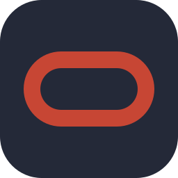
    </td>
  </tr>
  <tr>
    <td><b>Infrastructure as Code</b></td>
    <td>
      
      
    </td>
  </tr>
  <tr>
    <td><b>Containers</b></td>
    <td>
      
      
      
      
      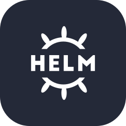
      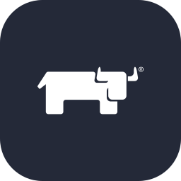
    </td>
  </tr>
  <tr>
    <td><b>CI/CD</b></td>
    <td>
      
      
      
      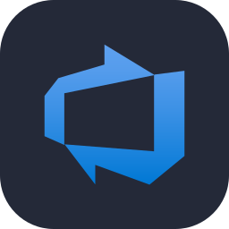
    </td>
  </tr>
  <tr>
    <td><b>Security</b></td>
    <td>
      
      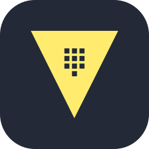
      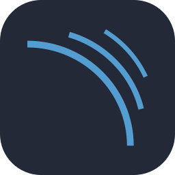
      
      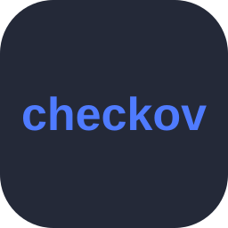
      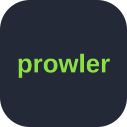
    </td>
  </tr>
  <tr>
    <td><b>Observability</b></td>
    <td>
      
      
      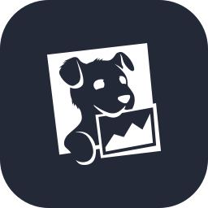
      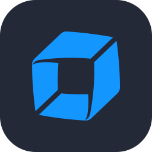
      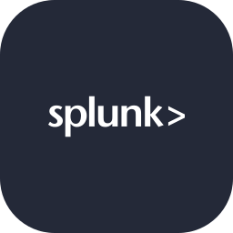
      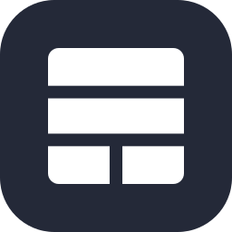
    </td>
  </tr>
  <tr>
    <td><b>Code</b></td>
    <td>
      
      
      
      
      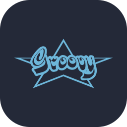
    </td>
  </tr>
  <tr>
    <td><b>AI</b></td>
    <td>
      
      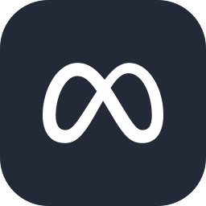
      
    </td>
  </tr>
</table>

## 💡 What I believe

```diff
+ Automate the second time, document the first
+ Security is part of the pipeline, not a phase after it
+ Fix the root cause, then make sure it can't come back
+ Least privilege by default, exceptions by evidence
- "It works on my machine"
```

<p align="center">
  <sub><code>status: Running</code> · Let's play ✨</sub>
</p>
